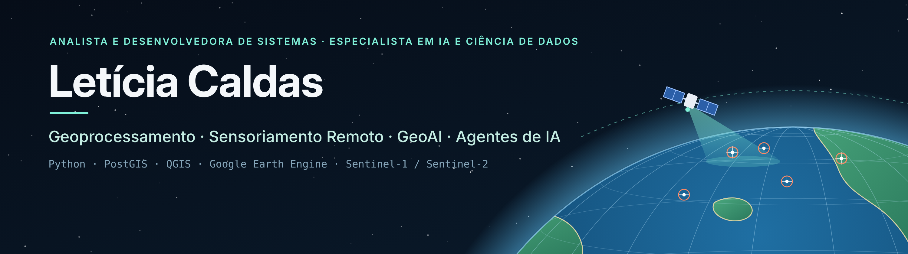

 

 

## Sobre mim

Sou **analista e desenvolvedora de sistemas** e **especialista em Inteligência Artificial e Ciência de Dados**. Trabalho com **geoprocessamento, sensoriamento remoto, GeoAI e agentes de IA**. Sou bolsista de pesquisa na **Embrapa**, onde processo e analiso dados geoespaciais com **Python, PostgreSQL/PostGIS e QGIS**, e aplico modelagem e inteligência artificial a riscos climáticos e recursos hídricos.

Na **GeoAI**, uno aprendizado de máquina e dados de satélite: tenho experiência com imagens ópticas (**Sentinel-2, Landsat e GeoEye-1**) e venho me aprofundando em **radar de abertura sintética (SAR)** com Sentinel-1 no **Google Earth Engine**. Em **agentes de IA**, pesquiso **sistemas multiagente integrados a LLMs** na Universidade Federal de Pelotas e desenvolvo simulações baseadas em agentes.

### Interesses

- Pré-processamento de imagens ópticas e SAR
- Detecção de alvos e monitoramento marítimo
- Mapeamento de inundações e riscos climáticos
- GeoAI: aprendizado de máquina aplicado a dados geoespaciais
- Agentes de IA: sistemas multiagente com LLMs e programação orientada a agentes (JaCaMo)
- Simulação baseada em agentes (GAMA)

 

## Tecnologias

**Linguagens e dados**

  
  
  
  
  
  
  
  
  
  
  
  
  

**Geoprocessamento e sensoriamento remoto**

  
  
  
  
  

**Ferramentas**

  
  
  
  
  
  
  
  
  

## Experiência

- **Bolsista de pesquisa – Embrapa Uva e Vinho** (2026–atual)
  Modelos de simulação na plataforma GAMA, processamento de dados geoespaciais em Python e desenvolvimento do CHS (Caldas Hydrological Simulator), voltado a riscos climáticos em encostas da Serra Gaúcha.
- **Bolsista de estímulo à inovação – Embrapa** (2025–atual)
  Bancos de dados geográficos em PostgreSQL/PostGIS, servidores Linux e scripts Python para automação e modelos de IA.
- **Pesquisadora colaboradora – UFPel** (2025–atual)
  Agentes autônomos, sistemas multiagente, JaCaMo e LLMs.
- **Bolsista de ensino, pesquisa e extensão – UFPel** (2019–2022)
  Geotecnologias em projetos de Engenharia Ambiental: imagens Sentinel-2 e Landsat, análise multitemporal, linha de costa e uso do solo.
- **Estágio no Laboratório de Sistemas Ubíquos e Paralelos (LUPS) – UFPel**
  Simulação quântica do interferômetro de Mach-Zehnder com Qiskit.

## Formação

- **Engenharia de Computação** – Universidade Federal de Pelotas (em andamento)
- **Engenharia de Software** – Centro Universitário UniFatecie (em andamento)
- **Análise e Desenvolvimento de Sistemas** – Centro Universitário UniFatecie (2024–2026)

## Trabalhos recentes

- **Cenários da cheia de 2024 do rio Taquari** (submetido ao SBSR): modelo de inundação com geoagentes, MDT de LiDAR em drone e validação com o índice MNDWI em imagem Sentinel-2.
- **Solos atingidos pela inundação de maio de 2024 no RS** e **APPs hídricas teóricas do RS** – trabalhos técnicos, 2026.
- **Revisão sistemática integrando sistemas multiagente e LLMs** – WESAAC, 2025.

## Contato

